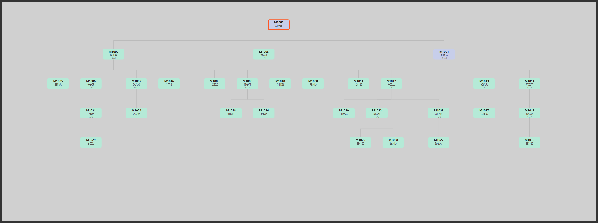

# 多层次团队业绩查询系统


**推荐关系表进去，团队业绩树出来。**

直销、分销、微商这类靠"谁推荐了谁"运转的团队，考核永远绕不开同一个问题：某个人名下到底带了多少人、这些人一共做了多少钱。三四层往上一拉 Excel 就乱，手算更不敢信。

这个工具把推荐关系建成有向图，一次算出全部会员的直推人数、团队总人数、团队累计营业额，再把整棵树渲染成可缩放、可点击高亮的 D3 网络图。



## 功能

- **团队累计营业额计算**：基于推荐关系有向图，自动计算每个会员的直推人数、团队总人数、个人营业额、下线营业额、团队累计营业额
- **单个会员查询**：交互式命令行查询任意会员的团队业绩及下线明细
- **D3.js 可视化**：生成团队推荐网络树形图（全公司图 + 最大子树图），支持缩放拖拽、点击高亮子树

## 快速开始

```bash
# 安装依赖
pip install -r requirements.txt

# 准备数据（参考下方数据格式）
# 将 推荐关系.xlsx 和 销售额.xlsx 放在脚本同目录下

# 生成全量团队业绩汇总
python 团队业绩计算.py

# 交互式查询单个会员
python 团队业绩计算.py --query

# 查询指定会员
python 团队业绩计算.py --id M1001

# 生成 D3 推荐网络可视化图
python 生成推荐网络图.py
```

## 数据格式

### 推荐关系.xlsx（4列）

| 会员ID | 会员姓名 | 推荐人ID | 推荐人姓名 |
|--------|----------|----------|------------|
| M1001 | 张建国 | | |
| M1002 | 李志强 | M1001 | 张建国 |
| M1003 | 王文博 | M1001 | 张建国 |

- 根节点（顶层推荐人）的推荐人ID留空
- 支持 .xlsx / .xls / .csv 格式

### 销售额.xlsx（3列）

| 会员ID | 会员姓名 | 营业额 |
|--------|----------|--------|
| M1001 | 张建国 | 12500.00 |
| M1002 | 李志强 | 8500.50 |

## 输出

### 团队业绩计算.py
- `团队业绩汇总.xlsx` — 包含"全部团队业绩"和"TOP200"两个工作表

### 生成推荐网络图.py
- `output/团队全网络.html` — 全公司推荐关系树形图
- `output/团队子树.html` — 最大推荐人的子树图

## 原理

使用 `networkx` 构建推荐关系有向图，通过 `nx.descendants()` 递归计算每个节点的全部下线，汇总下线营业额得到团队累计营业额。

可视化使用 D3.js v7 的 `d3.tree()` 布局，节点按层级严格水平对齐，连线为直角阶梯折线，支持缩放、拖拽、点击高亮子树。

## 依赖

- pandas — 数据处理
- networkx — 图计算
- openpyxl — Excel 读写
- xlsxwriter — Excel 输出格式化
- D3.js — 前端可视化（CDN 加载，无需安装）

## 目录结构

```
.
├── 团队业绩计算.py       # 核心计算脚本
├── 生成推荐网络图.py      # D3 可视化生成
├── d3_render.py           # D3 渲染引擎
├── 查询会员.bat           # Windows 快捷启动（交互查询）
├── 生成汇总.bat           # Windows 快捷启动（全量汇总）
├── 推荐关系.xlsx          # 示例数据（替换为你的数据）
├── 销售额.xlsx            # 示例数据（替换为你的数据）
├── requirements.txt
└── README.md
```

## License

MIT
